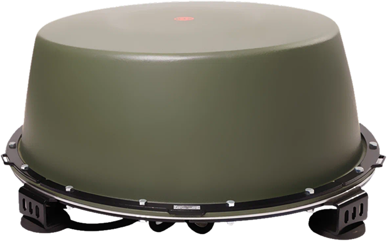

# _design — дизайн-система пакета «ДВА ГОРИЗОНТА»

Источник правды по брифу: `../../00_БРИФ_ИНФОГРАФИКИ.md` (§5 форматы, §6 визуальная система).
Этот каталог — общий для всех макетов. **Цвета, шрифты и правила меняются только здесь.**
Постеры P01–P10 наследуют систему через два файла: `tokens.css` → `poster.css`.

---

## 1. Что в папке

| Путь | Что это |
|---|---|
| `tokens.css` | копия `kilowatt/design/tokens.css` + блок «Дополнения» (`--p-*`: холсты, поля, кегли). Цвет/шрифты — из каталога, не менять. |
| `poster.css` | каркас постера, сетка 12 колонок, компоненты, форматы wide/story, печать. |
| `template.html` | рабочий каркас с комментариями и шпаргалкой компонентов. **Стартовая точка любого постера.** |
| `fonts/` | локальные OFL-шрифты: Sofia Sans Extra Condensed (VF), Oswald (VF), Tektur (VF), Unbounded (VF). Других `@font-face` в пакете нет: Dela Gothic / Days One из каталога не используются и удалены, чтобы офлайн-открытие не давало 404. |
| `img/brand/` | логотипы «В ОКОПЕ»: `logo_w_word` (вербалка), `logo_w_full`, `logo_w_emblem`, `logo_d_full`. |
| `img/cut/` | реальные вырезки товаров с прозрачным фоном (из `kilowatt/design/refs/cut`, получены вырезанием из фото). |
| `img/product/` | реальные фото товаров на белом фоне (из `kilowatt/catalog/assets/img/products`), для моделей без вырезки. |
| `_preview.png` | контрольный рендер `template.html` 1080×1350 — эталон системы. |

Именование вырезок — по модели: `img/cut/k12m.png`, `img/cut/signal-m2.png`,
`img/cut/tp-4-28a.png`, `img/cut/shtora-k12.png`, `img/cut/rebus-4.png`,
`img/cut/pole-31.png`, `img/cut/ip-24-100.png`, `img/cut/trenoga.png`,
`img/cut/kronshteyn-700.png`, `img/cut/tp-7-100.png`, `img/cut/tp-8-100.png`.
Фото на белом: `img/product/k8m.png`, `fpv-8m.png`, `k15m.png`, `fpv-12.png`,
`fpv-7-moto.png`, `k12m-bag-box.png`, `tp-4-50a.png`, `tp-4-50b.png`,
`t-9.png`, `preobrazovatel.png`, `blok-rele.png`, `shch-60a.png`, `modul-fpv-140.png`.

---

## 2. Как запустить новый постер

1. Скопируй `template.html` → `../posters/P0X_имя.html` (имя — по конвенции брифа §5).
2. Пути к CSS и картинкам из `posters/` — с префиксом `../_design/`:
   ```html
   <link rel="stylesheet" href="../_design/tokens.css">
   <link rel="stylesheet" href="../_design/poster.css">
   
   ```
   (в `template.html` пути без `../`, потому что он лежит внутри `_design/`).
3. Тему ставь на `<body>`: `class="theme-quiet grain"` (B2B, тёплый белый) или
   `class="theme-field grain"` (розница/поле, графит-олива). `grain` — единственная
   текстура, не убирать и не усиливать.
4. Формат: `<main class="poster">` 1080×1350; `poster poster--wide` 1920×1080;
   `poster poster--story` 1080×1920.
5. Сожми контент до одного вывода. Проверь рендером (см. §7) и по чек-листу §8.

Шрифты уже подключены в `tokens.css`; **никаких Google Fonts и CDN** — файл должен
открываться офлайн и одинаково рендериться.

---

## 3. Сетка и размеры (не менять)

| Параметр | Значение |
|---|---|
| Холст | 1080×1350 px (4:5); wide 1920×1080; story 1080×1920 |
| Поля | 64 px (wide — 80 px) со всех сторон |
| Колонки | 12, межколоночный шаг 16 px, рабочая ширина 952 px |
| Зона безопасности | ничего ближе 24 px к краю, кроме элементов самой линейки-шкалы |
| Минимальный кегль | 13 px (`--p-label`) — подписи, легенды, колофон |
| Основной текст | 14–16 px, вывод-лид 26 px, плакатный заголовок 96–124 px |
| Вертикальный ритм | 30 px между блоками рабочей зоны, 46 px от шапки до интро |
| Футер | сильная линия 2 px + CTA; прижат к низу (`margin-top:auto`) |

Сетка: `.p-grid` + `.p-c-1…12`. Быстрые варианты: `.p-cols-2/3/4`.
Никаких произвольных ширин «на глаз» — только колонки.

---

## 4. Две темы одного бренда

| | `.theme-quiet` (B2B: P04–P06, P08, P10) | `.theme-field` (розница: P01, P02, P07, P09) |
|---|---|---|
| Фон | тёплый белый `#F4F1EA` | графит-олива `#1C2317` |
| Текст | графит `#1D1E1A` | бумажный белый `#EDE8D7` |
| Акцент | сигнальный оранжевый `#C8451F` | кислотный лайм `#C9F24B` |
| Характер | «инженерный кабинет»: воздух, тонкие линии, плотные таблицы | «полевой плакат»: крупный заголовок, большое фото, контраст |

P03 «Эшелон» — гибрид: выбирай одну тему и держи её. Один макет = одна тема.

**Один акцент на макет.** Акцент — сигнал: кикер, одно слово заголовка, единица
измерения у цифры, ключевой CTA. Акцент **никогда** не фон, не плашка, не рамка
и не второй цвет. Если хочется «ещё немного цвета» — нужен воздух, а не цвет.

---

## 5. Типографика

| Роль | Шрифт | Класс |
|---|---|---|
| Плакатный заголовок | Sofia Sans Cond 800, uppercase | `.p-title` / `.p-title--sm` |
| Служебные подписи, заголовки секций | Oswald 500–600 | `.p-label`, `.p-kicker`, `.p-section__title` |
| Цифры, ТТХ, метки | Tektur 500, табличные цифры | `.p-tech`, `.p-fact__val`, `.p-table__v` |
| Основной текст | Segoe UI | `.p-lead`, `.p-horizon__list`, `.p-trust__item` |

Правила: заголовок — одна мысль, ≤2 строк; вывод — одна фраза, ≤3 строк;
подписи капсом с разрядкой .08–.16em; единицы измерения отдельным `<i>` в
`.p-fact__val` (акцент); перенос строк `text-wrap: balance/pretty` включён.
Не использовать Unbounded/Dela Gothic в постерах — они для обложки каталога.

---

## 6. Компоненты (всё в `poster.css`, примеры — в `template.html`)

- **Шапка** `.poster__head` — вербалка «В ОКОПЕ», «НПО „Киловатт“ · производитель», номер/дата.
- **Кикер** `.p-kicker` — акцентная черта + капс.
- **Заголовок** `.p-title` (+ `.p-accent` для одного слова).
- **Вывод** `.p-lead` — один абзац с `strong`-акцентом.
- **Фото-плашка** `.p-plate` — фото **только** реальное, на бумажной плашке, `mix-blend-mode: multiply`, подпись `.p-plate__cap`.
- **Тех-таблица** `.p-table` — открытый реестр на волосяных линиях.
- **Факты** `.p-facts` — 3–4 приборные цифры; длинные значения — `.p-facts--3` или `.p-fact__val--sm`.
- **Купольная схема** `.p-dome` — SVG «паспортный чертёж»: линии `currentColor`, размеры классом `.p-dome__accent`, подписи ≥13 px на холсте (учитывай масштаб viewBox!).
- **Легенда** `.p-legend` — подпись + значение.
- **Два горизонта** `.p-horizons` / `.p-horizon`.
- **Семейства линейки** `.p-families` / `.p-family`.
- **Эшелон** `.p-steps` / `.p-step` (+ `.p-steps--row` для wide).
- **Ядро доверия** `.p-trust`.
- **Линейка 41 позиции** `.p-ruler`.
- **Слоган** `.p-pull`.
- **Футер** `.poster__foot` — CTA строго по брифу + колофон.

**Запрещено:** карточки с тенями/скруглениями, градиенты, неон, стекло, обводки-хайлайты, иконки-эмодзи, чужие цвета. Объём даёт линия и воздух.

---

## 7. Рендер и проверка

```powershell
$chrome = "C:\Program Files\Google\Chrome\Application\chrome.exe"
$profile = Join-Path $env:TEMP "chp_design"
& $chrome --headless=new --disable-gpu --hide-scrollbars --no-first-run `
  --user-data-dir="$profile" `
  --screenshot="<абсолютный путь>\P01_dva_gorizonta.png" `
  --window-size=1080,1350 --force-device-scale-factor=1 `
  --virtual-time-budget=4000 `
  "file:///<abs-путь>/infographics/02_МАКЕТЫ/posters/P01_dva_gorizonta.html"
```

- Основной PNG: `--window-size=1080,1350 --force-device-scale-factor=1`.
- 2×: то же с `--force-device-scale-factor=2` (получится 2160×2700).
- wide: `--window-size=1920,1080`; story: `--window-size=1080,1920`.
- `--virtual-time-budget=4000` обязателен: иначе шрифты могут не успеть загрузиться.
- Отладочная сетка границ: `<body class="debug">` (не оставлять в финале).

---

## 8. Чек-лист перед сдачей (каждый постер)

1. [ ] Один вывод: постер пересказывается одной фразой.
2. [ ] Заголовок читается с телефона (проверь превью на 390 px ширины).
3. [ ] Ничего не обрезано и не вылезает за 64 px поля; нет горизонтального скролла.
4. [ ] Шрифты локальные (Sofia/Oswald/Tektur/Segoe), не Arial и не Times.
5. [ ] Один акцент; теней/градиентов/неона/стекла нет.
6. [ ] Фото — реальная вырезка на `.p-plate`, не ИИ и не сток.
7. [ ] Все цифры — из `01_ФАКТЫ/claims.json`, есть `claim_id` (в комментарии к блоку).
8. [ ] Цен нет: «цена по запросу» / «КП под задачу».
9. [ ] CTA на месте: `@vokope_ru` · `+7 999 136-71-42` · «Доставка по РФ · Самовывоз в Москве».
10. [ ] Номер постера и дата в колофоне; подписи ≥13 px.
11. [ ] Текст без нейрослопа: нет формулировок из `01_ФАКТЫ/BANNED.md`.
12. [ ] Рендер 1080×1350 проверен глазами (read image), 2× — по возможности.

---

## 9. Зоны записи и статусы

- `_design/` — **designer-a**. Designer-b использует систему как есть; если нужен
  новый компонент — попроси designer-a, не правь `poster.css` молча (версии разъедутся).
- Постеры: designer-a — P01–P03; designer-b — P04–P10, wide/, story/.
- «Официальный дилер» — со слов владельца, документ запрошен; в макетах только
  короткая формулировка «официальный дилер», без регалий.
- Цены не публикуем ни в одном файле пакета.
- Спорные цифры — в `01_ФАКТЫ/SPORY.md`, в макеты не попадают до решения фактчекера.
